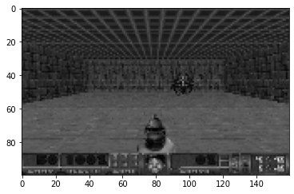
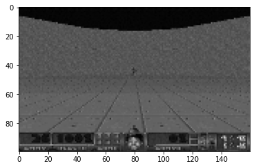
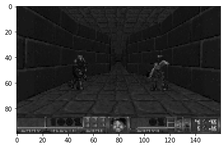
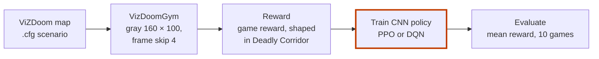

# Doom AI: Comparing DQN and PPO Algorithms

[](https://www.python.org/)
[](https://stable-baselines3.readthedocs.io/)
[](https://github.com/Farama-Foundation/ViZDoom)
[](LICENSE)

**Agents learn to play Doom (1993) from the screen alone, and PPO is compared with DQN on three maps.**

<p>
  
  
  
</p>

*What the agent sees in Basic, Defend the Center and Deadly Corridor: one grayscale 160 × 100 frame. Notebook outputs.*

Think of a new player dropped into a level with no instructions.
They try buttons, notice that a hit earns points and wasted ammo costs them, and slowly play better.
Each agent here learns the same way, from pixels and a reward.
PPO beat DQN on all three maps.

- **What it does:** wraps three ViZDoom maps as Gym environments and trains a CNN policy on each, with PPO and with DQN.
- **Why you can trust the comparison:** both agents get the same environment, and both are scored on 10 games with `evaluate_policy`.
- **What is included:** one notebook per map, all six trained models, the TensorBoard logs and the paper.

Bachelor's project, Faculty of Technology, Firat University, 2023, by Tarık Bulut.
Sibling project, same paper: [Mario AI](https://github.com/Estaed/Mario-AI).

## Quick start

```bash
git clone https://github.com/Estaed/Doom-AI.git
cd Doom-AI
pip install vizdoom matplotlib gym opencv-python
pip install torch torchvision torchaudio --index-url https://download.pytorch.org/whl/cu117
pip install stable-baselines3[extra]==1.8.0
git clone https://github.com/mwydmuch/ViZDoom Github_VizDoom/VizDoom
jupyter notebook Doom_AI_Basic.ipynb
```

The install lines come from the notebooks' own cells. The notebook output shows Stable-Baselines3 1.8.0 with gym 0.21, so the version is pinned here.
The code uses the older gym API: `step()` returns four values.
The notebooks load the map files from `Github_VizDoom/VizDoom/scenarios/`, which is why ViZDoom is cloned there.

Run each notebook from the top. In section 5, run either the PPO cell or the DQN cell, then `model.learn(...)`.
To watch a saved agent, section 6 loads it from `train/`, for example `DQN.load('./train/train_basic/DQN/best_model_70000')`.

`Doom_AI_DeadlyCorridor.ipynb` loads `deadly_corridor_s1.cfg` to `deadly_corridor_s5.cfg`.
These five files are in neither this repo nor ViZDoom.
They are copies of `deadly_corridor.cfg` with the enemy level set from 1 to 5. The game variables are set to `HEALTH DAMAGE_TAKEN HITCOUNT SELECTED_WEAPON_AMMO`.

## How it works



1. **Map.** ViZDoom runs Doom from a scenario file: Basic, Defend the Center or Deadly Corridor.
2. **Environment.** A custom `VizDoomGym` class turns the game into a Gym environment. Basic and Defend the Center have 3 actions; Deadly Corridor has 7.
3. **Screen.** Each frame is converted to gray and resized to 160 × 100 with cubic interpolation. Every action is held for 4 frames.
4. **Reward.** Basic and Defend the Center use the game's own reward. Deadly Corridor shapes it from the change in damage taken, hits and ammo: `movement_reward + damage_taken_delta*10 + hitcount_delta*200 + ammo_delta*5`.
5. **Curriculum.** Deadly Corridor trains 400,000 steps at enemy level 1, then 50,000 steps at each of levels 2 to 5.
6. **Train.** A `CnnPolicy` learns with PPO or DQN. A callback saves a checkpoint every N steps.
7. **Evaluate.** `evaluate_policy` plays 10 games and returns the mean reward.

## Results

| Map | Goal | Steps | PPO mean reward | DQN mean reward |
|---|---|---|---|---|
| Basic | shoot one monster fast, with little ammo | 70,000 | **89.4** | −27.2 |
| Defend the Center | survive as monsters close in from all sides | 100,000 | **17.1** | 10.3 |
| Deadly Corridor | reach the end past 6 shooting enemies | 600,000 | **934.27** | 770.20* |

**PPO was more stable and generalised better across the Doom maps.** DQN performed well but needed more training time.
In Basic, PPO used one bullet and reached the target fastest; DQN used more bullets than needed.
In Defend the Center, PPO survived longer because it wasted less ammo.
In Deadly Corridor, PPO picked up the weapons of enemies it killed, which raised its ammo and its reward.

All scores are from the paper. The Basic and Defend the Center DQN scores also appear in the notebook outputs.

\* The DeadlyCorridor notebook's `evaluate_policy` cell prints 77.2 instead, and its five test episodes score between 418 and 1236.

For the full findings, read the paper: [`Playing Mario and Doom with RL_EN.pdf`](Playing%20Mario%20and%20Doom%20with%20RL_EN.pdf).

<details>
<summary><b>Hyperparameters per map</b></summary>

All models use `CnnPolicy`. Every DQN uses batch size 64, `learning_starts` 2,000 and γ 0.95.

| Map | PPO | DQN | Checkpoint every |
|---|---|---|---|
| Basic | lr 1e-4, `n_steps` 2048 | lr 1e-4, buffer 10,000 | 70,000 steps |
| Defend the Center | lr 1e-4, `n_steps` 4096 | lr 1e-4, buffer 20,000 | 10,000 steps |
| Deadly Corridor | lr 1e-5, `n_steps` 8192, clip 0.1, γ 0.95, GAE λ 0.9, entropy 0.01 | lr 1e-4, buffer 40,000 | 50,000 steps |

`Set_Learning_rate.PNG` is a sheet of PPO trial runs with their scores (n_steps, gamma, learning rate, clip range, GAE). It is Figure 7 in the paper.

</details>

<details>
<summary><b>What the paper discusses</b></summary>

- **Performance:** PPO and DQN are compared on training efficiency, reward and gameplay, map by map.
- **DQN in Basic:** 70,000 steps were not enough for DQN; the paper expects that more steps would close the gap.
- **Mario:** the paper also covers Super Mario Bros. It is the same paper as in the [Mario AI](https://github.com/Estaed/Mario-AI) repository.

</details>

<details>
<summary><b>Files in this repository</b></summary>

| Path | What it is |
|---|---|
| `Doom_AI_Basic.ipynb` | Basic map: environment, training, testing |
| `Doom_AI_DefendCenter.ipynb` | Defend the Center map |
| `Doom_AI_DeadlyCorridor.ipynb` | Deadly Corridor map, with reward shaping and the curriculum |
| `train/train_basic/{PPO,DQN}/best_model_70000.zip` | Trained Basic models (58 MB, 77 MB) |
| `train/train_defend/{PPO,DQN}/best_model_100000.zip` | Trained Defend the Center models (58 MB, 77 MB) |
| `train/train_deadly_corridor/{PPO,DQN}/best_model_600000.zip` | Trained Deadly Corridor models (58 MB, 77 MB) |
| `logs/` | TensorBoard logs per map: `log_basic`, `log_defend`, `log_deadly_corridor` |
| `Set_Learning_rate.PNG` | PPO hyperparameter trial sheet (Figure 7 in the paper) |
| `Playing Mario and Doom with RL_EN.pdf` | The paper: method, results and conclusions for Mario and Doom |
| `docs/img/` | Frames in this README, decoded from the notebook outputs |

To browse the logs: `tensorboard --logdir logs`.

</details>

## Author

Tarık Bulut. Questions or suggestions are welcome as an issue.

## Licence

[MIT](LICENSE).
